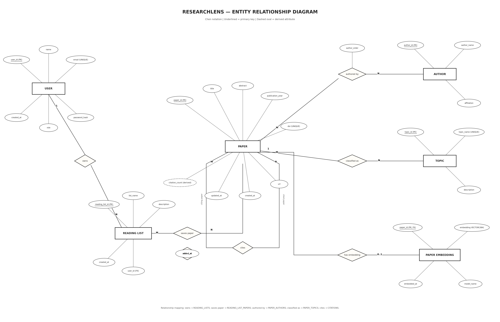

# ResearchLens — Research Paper Discovery & Knowledge Mapping

ResearchLens is a web-based research paper discovery platform that helps
students and researchers find relevant academic papers using semantic search.

Traditional keyword-based search can miss relevant research when different
terminology is used. ResearchLens addresses this by converting paper content
and user queries into vector embeddings and retrieving semantically similar
papers using cosine similarity.

## Features

- Semantic search for research papers.
- Year and topic-based filtering.
- Paper metadata and author information.
- Citation network exploration.
- Personal reading lists.
- User authentication and role-based access control.
- Administrator dashboard and user management.
- Research analytics and visualizations.
- Vector similarity search using pgvector.

## Technology Stack

| Component | Technology |
|---|---|
| Frontend | Next.js, React, TypeScript |
| Styling | Tailwind CSS |
| Backend | Python, FastAPI |
| Relational Database | PostgreSQL |
| Vector Search | pgvector |
| Embedding Model | sentence-transformers/all-MiniLM-L6-v2 |
| Authentication | JWT, Argon2 password hashing |

## Architecture

1. The Next.js frontend accepts user queries and displays results.
2. Next.js API routes forward requests to the FastAPI backend.
3. FastAPI validates requests and performs application logic.
4. Sentence Transformers converts search queries into embeddings.
5. PostgreSQL stores paper metadata and relational information.
6. pgvector performs vector similarity search to retrieve relevant papers.

## Database Design

The database contains the following tables:

- users
- papers
- authors
- paper_authors
- topics
- paper_topics
- citations
- paper_embeddings
- reading_lists
- reading_list_papers

The database uses primary keys, foreign keys, unique constraints,
check constraints, composite keys and transactions to maintain data integrity.

## Advanced Database Features

- Nested SQL queries
- Correlated subqueries
- Recursive CTEs
- Joins and aggregate queries
- Window functions
- Database views
- Stored functions
- Triggers
- Full-text search indexes
- HNSW vector indexes
- Vector similarity search
- Transaction-based DML operations

## Authentication and Authorization

ResearchLens supports two roles:

- Researcher: Can search papers and manage personal reading lists.
- Admin: Has administrative access, including user management and analytics.

Passwords are hashed using Argon2. Authentication uses JWT-based sessions
stored in HTTP-only cookies. Authorization is enforced through backend
role-based access checks.

## Project Structure

```text
researchlens-app/
│
├── app/                         # Next.js pages and API routes
│   ├── admin/
│   ├── analytics/
│   ├── api/
│   ├── citations/
│   ├── login/
│   ├── reading-lists/
│   ├── register/
│   ├── layout.tsx
│   └── page.tsx
│
├── database/                    # SQL scripts and Python backend
│   ├── schema.sql
│   ├── seed.sql
│   ├── extra_papers.sql
│   ├── advanced_queries.sql
│   ├── dml_operations.sql
│   ├── functions.sql
│   ├── triggers.sql
│   ├── views.sql
│   ├── api.py
|   ├── generate_embeddings.py
│  L └─ semantic_search.py
│
├─docs/                        # Project documentation
│   ├── DATABASE_IMPLEMENTATION.md
│   ├── ER_DIAGRAM.md
│   └── TECHNOLOGY_JUSTIFICATION.md
│
├── public/                      # Static assets
├── .env                         # Local environment configuration (not committed)
├── .gitignore
├── package.json
├── README.md
└── tsconfig.json

```

## Setup and Execution

### Prerequisites

- Node.js and npm
- Python 3
- PostgreSQL
- pgvector PostgreSQL extension

### 1. Clone the repository

```bash
git clone <YOUR_GITHUB_REPOSITORY_URL>
cd researchlens-app
```

---

## Entity Relationship Diagram

The following diagram illustrates the entities, attributes, primary keys, foreign keys, and relationships in ResearchLens.


